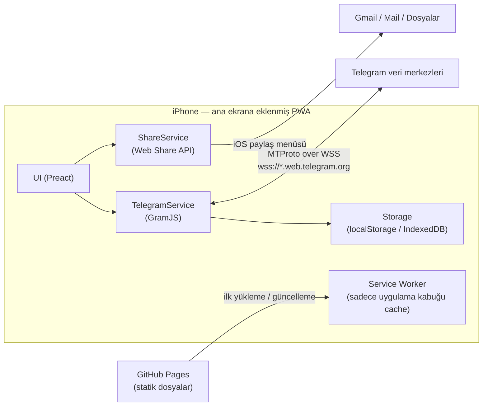
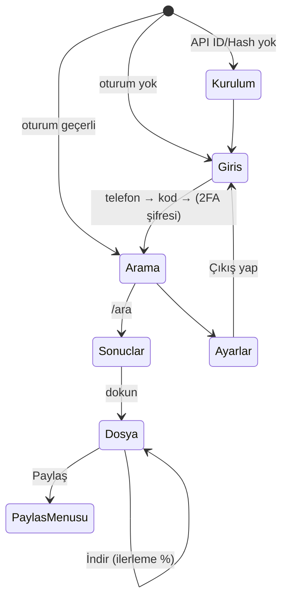

# TG Doc Finder — Mimari

Telegram'da üye olunan grup ve kanallarda **doküman arayan**, bulunan dosyayı
iPhone'un **paylaş menüsü** ile Gmail/Mail'e (veya herhangi bir uygulamaya)
gönderen, **sunucusuz** bir iPhone web uygulaması (PWA).

> Bu doküman Claude Code ile geliştirme için tek kaynak (source of truth).
> Bir karar değişirse önce burayı güncelle, sonra kodu.

---

## 1. Hedefler ve kapsam

**Yapacakları**
- Tüm sohbetlerde (veya seçili gruplarda) dosya adı / mesaj metnine göre doküman araması.
- Sonuç listesi: dosya adı, grup adı, tarih, boyut.
- Dosyayı indirip iOS paylaş menüsünü açma (Gmail, Mail, Dosyalar, WhatsApp…).
- Ana ekrana eklenip uygulama gibi çalışma; ev Wi-Fi'ı dışında da çalışma.

**Yapmayacakları (v1)**
- PDF içeriğinde arama (Telegram araması bunu desteklemez).
- Mesaj gönderme, sohbet okuma, bildirim.
- Sunucu, veritabanı, Gmail API. (E-posta gönderimini iOS paylaş menüsü yapar.)

**Başarı kriteri:** iPhone'da uygulamayı aç → kelime yaz → 10 sn içinde sonuç →
dosyaya dokun → indir → Paylaş → Gmail'de ekli taslak.

---

## 2. Mimari genel bakış

Uygulama tamamen iPhone'un içinde çalışır. GitHub Pages yalnızca statik
dosyaları (HTML/JS/CSS) sunar; Telegram trafiği doğrudan telefondan
Telegram'a gider. Arada sunucu yok.



### Bileşenler

| Bileşen | Sorumluluk | Teknoloji |
| --- | --- | --- |
| **UI** | Ekranlar, durum yönetimi, kullanıcı etkileşimi | Preact + `@preact/signals`, TypeScript |
| **TelegramService** | Bağlanma, giriş, arama, indirme, yeniden bağlanma. GramJS'i UI'dan izole eden tek katman | `telegram` (GramJS) npm paketi |
| **Storage** | API kimlik bilgileri, oturum, ayarlar, son aramalar | `localStorage` (küçük veriler), gerekirse `idb-keyval` |
| **ShareService** | `File` oluşturma, `navigator.canShare/share`, indirme yedeği | Web Share API Level 2 |
| **Service Worker** | Uygulama kabuğunu cache'leyip hızlı açılış, PWA kurulabilirliği | `vite-plugin-pwa` (Workbox) |
| **Build / Deploy** | Paketleme, Node polyfill'leri, GitHub Pages'e otomatik yayın | Vite, `vite-plugin-node-polyfills`, GitHub Actions |

---

## 3. Temel teknik kararlar

| # | Karar | Gerekçe | Reddedilen alternatif |
| --- | --- | --- | --- |
| D1 | **PWA**, native uygulama değil | Mac/Xcode ve yıllık 99 $ geliştirici hesabı gerekmez, 7 günlük yeniden imzalama yok | Swift uygulaması |
| D2 | **Sunucusuz**: Telegram istemcisi tarayıcıda (GramJS) | Pi'ye/sunucuya bağımlılık yok, her yerden çalışır | Pi'de API + PWA arayüz |
| D3 | **E-posta = iOS paylaş menüsü** | Gmail API/OAuth kurulumu yok. Gmail iOS 25 MB üstü eki Drive linkine, Apple Mail ise Mail Drop'a çevirir | Tarayıcıdan Gmail API |
| D4 | **Preact + Vite + TypeScript** | Küçük paket (GramJS zaten büyük), bileşen yapısı, Claude Code için tanıdık | Vanilla JS (ekran sayısı arttıkça dağılır), React (daha ağır) |
| D5 | **API ID/Hash koda gömülmez**, ilk açılışta girilir, cihazda saklanır | Repo public olabilir, sır sızmaz | `.env` ile build'e gömmek |
| D6 | **İki adımlı paylaşım**: önce "İndir", bitince "Paylaş" | iOS, `navigator.share()` için taze kullanıcı dokunuşu ister; uzun indirme sonrası dokunuş geçersiz olur ve `NotAllowedError` verir | Tek dokunuşta indir+paylaş (iOS'ta çalışmaz) |
| D7 | **Ayrı Telegram oturumu** (Pi botununkinden bağımsız) | Aynı oturum iki istemcide kullanılırsa Telegram iptal edebilir. Aynı API ID kullanılabilir | Pi'nin `session.session`'ını taşımak |
| D8 | **GitHub Pages + public repo** | Ücretsiz, HTTPS (PWA ve Web Share için şart). Private repo'dan Pages ücretli plan ister; kodda sır olmadığı için public sorun değil | Cloudflare Pages (ek hesap) |

---

## 4. Ekranlar ve akış



1. **Kurulum** — API ID ve API Hash alanları ([my.telegram.org](https://my.telegram.org) → API development tools). Kısa açıklama + "Kaydet".
2. **Giriş** — Telefon numarası → Telegram'dan gelen kod → varsa iki adımlı doğrulama şifresi. Hata mesajları Türkçe (`PHONE_CODE_INVALID` → "Kod hatalı").
3. **Arama** — Arama kutusu (Enter/"Ara" ile tetiklenir, yazarken değil), kapsam seçici: **Tüm sohbetler / Seçili gruplar**, son 5 arama.
4. **Sonuçlar** — Kart listesi: dosya adı (kalın), grup adı, tarih (gg.aa.yyyy), boyut (MB). En fazla 30 sonuç, altta "Daha fazla".
5. **Dosya** — Bilgiler + **İndir** butonu → ilerleme çubuğu → **Paylaş** butonu belirir. Ek olarak "Telegram'da aç" linki.
6. **Ayarlar** — Seçili gruplar (sohbet listesinden çoklu seçim), oturum bilgisi, **Çıkış yap** (Telegram'dan da oturumu kapatır), **Tüm verileri sil**.

UI dili Türkçe. Tasarım: iOS'a uygun, büyük dokunma alanları (min 44 px), sistem fontu, açık/koyu mod (`prefers-color-scheme`), `safe-area-inset` boşlukları.

---

## 5. Modül tasarımı

### 5.1 TelegramService (`src/telegram/client.ts`)

GramJS'e doğrudan erişen **tek** modül. UI yalnızca bu arayüzü kullanır:

```ts
interface TelegramService {
  init(creds: ApiCreds, session: string | null): Promise<AuthState>; // 'authorized' | 'needs-login'
  sendCode(phone: string): Promise<void>;
  signIn(code: string): Promise<'ok' | 'needs-password'>;
  checkPassword(password: string): Promise<void>;
  logOut(): Promise<void>;

  search(q: string, opts: { chatIds?: string[]; offset?: SearchCursor }):
    Promise<{ items: DocResult[]; next?: SearchCursor }>;
  listGroups(): Promise<ChatInfo[]>;            // Ayarlar'daki grup seçici için
  download(ref: DocRef, onProgress: (pct: number) => void, signal?: AbortSignal):
    Promise<File>;
  ensureConnected(): Promise<void>;             // uygulama ön plana gelince
}

type DocResult = {
  ref: DocRef;            // { chatId, msgId } — mesajı yeniden almak için yeterli
  fileName: string;       // yoksa `telegram_<msgId><ext>`
  mimeType: string;
  size: number;           // byte
  date: number;           // unix saniye
  chatTitle: string;
  link?: string;          // https://t.me/<username>/<id> veya t.me/c/<id>/<msgId>
};
```

**İstemci ayarları**
```ts
new TelegramClient(new StringSession(saved ?? ''), apiId, apiHash, {
  useWSS: true,               // tarayıcıda WebSocket, port 443
  connectionRetries: 5,
  floodSleepThreshold: 60,    // 60 sn altındaki FLOOD_WAIT'leri otomatik bekle
  deviceModel: 'TG Doc Finder (iPhone)',
  systemVersion: 'iOS PWA',
  appVersion: '<package.json version>',
});
```
Her başarılı girişten sonra `client.session.save()` → Storage'a yazılır.

**Arama mantığı**
- **Tüm sohbetler:** `Api.messages.SearchGlobal` — `q`, `filter: new Api.InputMessagesFilterDocument()`, `limit: 30`. Sayfalama için cevaptaki `nextRate` + son mesajın peer/id'si (`offsetRate`, `offsetPeer`, `offsetId`) `SearchCursor` olarak döner.
- **Seçili gruplar:** her grup için `Api.messages.Search` (aynı filtre, `limit: 30`), en fazla **3 paralel** istek, sonuçlar tarihe göre birleştirilip ilk 30 alınır.
- Kendi "Kayıtlı Mesajlar"ındaki sonuçlar elenir.
- Dönen `messages`, `chats`, `users` listeleri eşleştirilerek `chatTitle` doldurulur (ek istek yapılmaz).

**İndirme**
- `client.getMessages(chatId, { ids: [msgId] })` ile taze mesaj (dosya referansları süreyle geçersizleşir).
- `client.downloadMedia(message, { progressCallback })` → `Uint8Array` → `new File([bytes], fileName, { type: mimeType })`.
- **150 MB üstü** dosyada indirmeden önce uyarı (iPhone belleği, dosya RAM'de tutulur).
- Son indirilen **1 dosya** bellekte tutulur, aynı dosyayı tekrar paylaşmak yeniden indirme gerektirmez.

**Bağlantı yaşam döngüsü (iOS'a özgü)**
- iOS, arka plandaki PWA'nın WebSocket'ini kapatır. `document.visibilitychange` → `visible` olduğunda `ensureConnected()` çağrılır (`client.connected` değilse `client.connect()`).
- İndirme sırasında uygulama arka plana atılırsa indirme yarıda kalır: UI "Uygulamadan çıkmayın" uyarısı gösterir; destekleniyorsa Screen Wake Lock API ile ekran açık tutulur.

**Hata eşleme** (`src/telegram/errors.ts`): GramJS `RPCError` → kullanıcı mesajı.

| Hata | Davranış |
| --- | --- |
| `PHONE_CODE_INVALID` / `PHONE_CODE_EXPIRED` | "Kod hatalı / süresi doldu", kodu tekrar iste |
| `SESSION_PASSWORD_NEEDED` | 2FA şifre ekranı |
| `AUTH_KEY_UNREGISTERED`, `SESSION_REVOKED` | Oturumu sil → Giriş ekranı |
| `FLOOD_WAIT_X` (X > 60) | "X sn sonra tekrar deneyin" |
| `FILE_REFERENCE_EXPIRED` | Mesajı yeniden al, indirmeyi bir kez tekrarla |
| Ağ hatası | "Bağlantı yok", otomatik yeniden deneme |

### 5.2 Storage (`src/storage.ts`)

| Anahtar | İçerik | Not |
| --- | --- | --- |
| `tdf.creds` | `{ apiId, apiHash }` | Kurulumda girilir |
| `tdf.session` | GramJS `StringSession` metni | **Hesaba tam erişim verir** (bkz. §7) |
| `tdf.settings` | `{ scope: 'all' \| 'selected', chatIds: string[] }` | |
| `tdf.recent` | Son 5 arama | |

Açılışta `navigator.storage.persist()` istenir. Tüm erişim tek modülden geçer
(ileride şifreleme eklemek için tek yer).

### 5.3 ShareService (`src/share.ts`)

```ts
async function shareFile(file: File): Promise<'shared' | 'cancelled' | 'downloaded'> {
  if (navigator.canShare?.({ files: [file] })) {
    try { await navigator.share({ files: [file], title: file.name }); return 'shared'; }
    catch (e) { if ((e as DOMException).name === 'AbortError') return 'cancelled'; throw e; }
  }
  // Yedek: <a download> ile blob indir (masaüstü tarayıcıda test için)
  ...
  return 'downloaded';
}
```
**Kural:** `shareFile` yalnızca "Paylaş" butonunun **click handler'ından, arada
`await` olmadan** çağrılır (D6). Dosya önceden hazır olmalı.

### 5.4 Service Worker

- `vite-plugin-pwa`, `registerType: 'prompt'`: yeni sürüm gelince "Güncelle" bandı.
- Sadece uygulama kabuğu (HTML/JS/CSS/ikonlar) precache edilir. **Telegram trafiği ve indirilen dosyalar asla cache'lenmez.**
- Manifest: `name: "TG Doc Finder"`, `short_name: "Doküman Bul"`, `display: "standalone"`, `start_url` ve `scope` = `/<repo>/`, 192/512 px ikonlar + `apple-touch-icon` (180 px).

---

## 6. Build ve deploy

### 6.1 GramJS'i tarayıcıda çalıştırma
GramJS Node.js için yazıldı; `Buffer`, `process`, `os`, `util` gibi modülleri kullanır.
- `vite-plugin-node-polyfills` ile `buffer`, `process`, `util`, `stream` vb. sağlanır.
- `os` için küçük bir stub (`src/shims/os.ts`: `type()`, `release()` vb.) ve `resolve.alias` ile yönlendirme.
- Bu kurulum **Faz 1'in ilk işi**: önce boş bir sayfada `TelegramClient` oluşturup bağlanmayı kanıtla, sonra UI'a geç.

### 6.2 GitHub Pages
- `vite.config.ts` → `base: '/tg-doc-finder/'`.
- `.github/workflows/deploy.yml`: `main`'e push → `npm ci` → `npm run test` → `npm run build` → `actions/upload-pages-artifact` → `actions/deploy-pages`.
- Repo ayarları: **Settings → Pages → Source: GitHub Actions**. Pages için repo **public** olmalı (D8).
- Adres: `https://ahmethamit.github.io/tg-doc-finder/`

### 6.3 İçerik güvenliği politikası (CSP)
`index.html` içinde meta CSP:
```
default-src 'self'; script-src 'self'; style-src 'self' 'unsafe-inline';
img-src 'self' data: blob:; connect-src 'self' wss://*.web.telegram.org;
worker-src 'self'; object-src 'none'; base-uri 'self'
```
Telegram'ın web veri merkezleri `wss://*.web.telegram.org` altında. Faz 1'de
bağlantı gerçekten bu host'lara gidiyor mu, tarayıcı konsolundan doğrula.
Gerekirse CSP'yi genişlet.

---

## 7. Güvenlik

- **Oturum metni = hesabın anahtarı.** `tdf.session` ele geçirilirse hesaba
  tam erişim sağlanır. Yalnızca iPhone'da, uygulamanın kendi deposunda durur.
  Hiçbir yere gönderilmez, loglanmaz, konsola yazılmaz.
- Ana ekran PWA'sının deposu Safari'den ayrıdır; başka siteler okuyamaz.
- Uygulama Telegram'da **Ayarlar → Cihazlar** altında "TG Doc Finder (iPhone)"
  olarak görünür. Telefon kaybolursa oradan oturum kapatılır.
- Repo public: koda API ID/Hash, telefon numarası, oturum **asla** girmez.
  `.gitignore`'a `.env*` ekli, CI'da secret yok.
- Üçüncü taraf script/CDN yok (CSP `script-src 'self'`). Analitik yok.
- **Faz 5 (opsiyonel):** PIN kilidi. Oturum metni WebCrypto ile şifrelenir
  (PBKDF2-SHA256, 310 000 iterasyon → AES-GCM 256). Açılışta PIN sorulur.

---

## 8. Klasör yapısı

```
tg-doc-finder/
├── ARCHITECTURE.md          ← bu dosya
├── CLAUDE.md                ← Claude Code çalışma kuralları
├── README.md                ← kurulum + iPhone'a ekleme adımları
├── package.json
├── vite.config.ts           ← base, polyfill'ler, PWA, os alias
├── tsconfig.json
├── index.html               ← CSP meta, apple-touch-icon, viewport-fit=cover
├── public/icons/            ← 180/192/512 px ikonlar
├── src/
│   ├── main.tsx
│   ├── app.tsx              ← ekran yönlendirme (durum makinesi, §4)
│   ├── state.ts             ← signals: auth, results, download durumu
│   ├── telegram/
│   │   ├── client.ts        ← TelegramService (§5.1)
│   │   ├── search.ts        ← global / seçili grup arama, birleştirme
│   │   ├── errors.ts        ← RPCError → Türkçe mesaj
│   │   └── types.ts
│   ├── storage.ts           ← §5.2
│   ├── share.ts             ← §5.3
│   ├── format.ts            ← boyut, tarih, dosya adı yardımcıları
│   ├── screens/             ← Setup, Login, Search, Results, FileDetail, Settings
│   ├── components/          ← Button, Card, ProgressBar, Banner…
│   ├── shims/os.ts
│   └── styles.css
├── tests/                   ← vitest: format, search birleştirme, errors
└── .github/workflows/deploy.yml
```

---

## 9. Geliştirme fazları

Her faz bağımsız olarak deploy edilebilir ve iPhone'da test edilebilir olmalı.

| Faz | İçerik | Kabul kriteri |
| --- | --- | --- |
| **0. İskelet** | Vite + Preact + TS, PWA manifest, ikonlar, GitHub Actions → Pages | iPhone'da adres açılır, "Ana Ekrana Ekle" ile tam ekran açılır |
| **1. GramJS spike** | Polyfill'ler, `TelegramService.init/sendCode/signIn/checkPassword`, oturumun saklanması | PWA'da giriş yapılır; uygulama kapatılıp açılınca giriş korunur; Telegram → Cihazlar'da görünür |
| **2. Arama** | Global arama, sonuç listesi, "Daha fazla", son aramalar | "Times" araması bilinen grupların dosyalarını getirir; boş sonuçta mesaj gösterilir |
| **3. İndir + Paylaş** | İndirme + ilerleme, iki adımlı paylaşım, 150 MB uyarısı, "Telegram'da aç" | 5 MB ve 40 MB PDF Gmail'e gönderilir (40 MB'lık Drive linki olarak) |
| **4. Ayarlar** | Grup seçici, kapsam anahtarı, çıkış yap, verileri sil | Seçili gruplar modunda yalnızca o grupların sonuçları gelir |
| **5. Sağlamlaştırma** | Yeniden bağlanma, hata eşleme, güncelleme bandı, Wake Lock, (opsiyonel) PIN | Uygulama 10 dk arka planda kalıp dönünce arama çalışır; uçak modunda anlamlı hata |

**Test**
- `vitest` ile saf fonksiyonlar: `format.ts`, sonuç birleştirme/sıralama, hata eşleme.
- Telegram'a bağlanan kod birim testlerde mock'lanır; gerçek test iPhone'da, §9'daki kabul kriterleriyle.
- Masaüstünde `npm run dev` ile geliştirme mümkün. **Not:** şirket ağı/proxy
  Telegram WebSocket'lerini engelleyebilir; gerçek bağlantı testini ev ağında veya
  doğrudan iPhone'da yap.

---

## 10. Riskler

| Risk | Etki | Önlem |
| --- | --- | --- |
| GramJS + Vite polyfill uyumsuzluğu | Uygulama açılmaz | Faz 1'i UI'dan önce yap; sorun çözülmezse GramJS'in hazır browser bundle'ını dene |
| iOS paylaşımda "dokunuş" kuralı | Paylaş menüsü açılmaz | D6: iki adımlı akış, `share()` öncesi `await` yok |
| Büyük dosya belleği | Sekme çöker | 150 MB uyarısı, tek dosya bellekte |
| iOS arka planda bağlantıyı keser | Arama/indirme yarıda kalır | `visibilitychange` → yeniden bağlan; indirme sırasında uyarı + Wake Lock |
| iOS depoyu silerse | Yeniden giriş gerekir | `storage.persist()`, giriş ekranı hızlı |
| Telegram oturumu kapatır (şüpheli giriş) | Yeniden giriş | Tutarlı `deviceModel`, makul istek hızı (arama yalnızca Enter ile) |
| GramJS bakım hızı | Yeni Telegram katmanlarında sorun | Sürümü `package.json`'da sabitle, güncellemeyi bilinçli yap |

---

## 11. Pi botuyla ilişkisi

Bu uygulama Pi'deki `telegram_drive_sync` botundan **bağımsızdır**. Ayrı oturum
kullanır, birbirini etkilemez. Pi'deki `/ara` ve `/gonder` komutları yedek olarak
çalışmaya devam edebilir; bu uygulama yayına girince kaldırılması opsiyoneldir.
